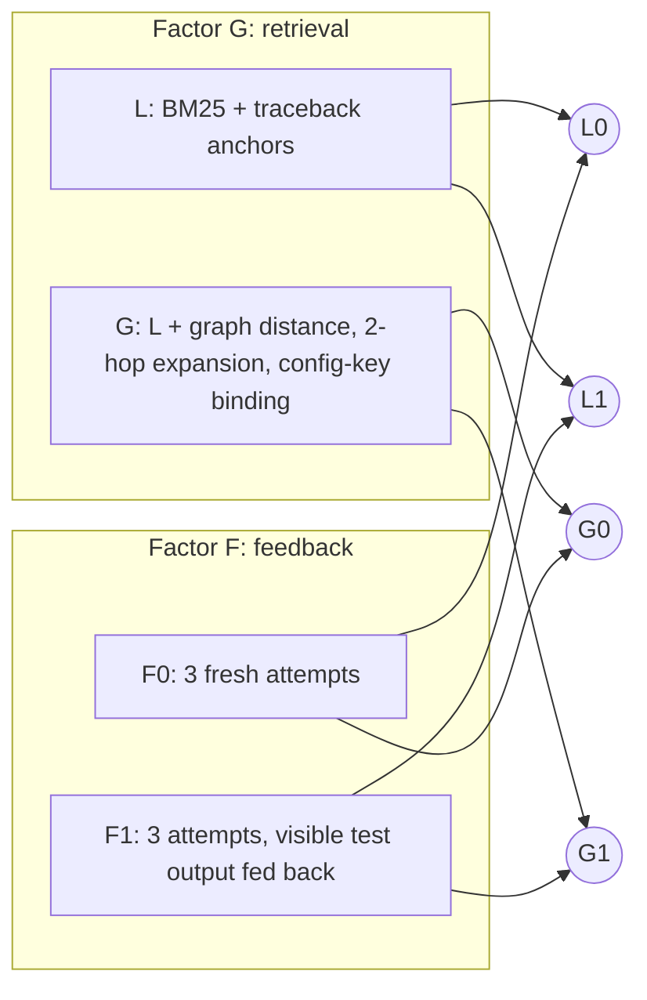

# TraceForge Explained

*The living encyclopedia of the TraceForge project. Start here.*

Last verified against the working tree: **2026-11-21** (branch `ruhan/stage-b-work`, no commits yet). This guide is a living document: every implementation statement was checked against the real files. If you change code, update the matching chapter (see the Docs role in `docs/orchestration/AGENT_ROLES.md`).

## 1. What is TraceForge, in plain words

Imagine a small web shop made of several programs (an API, a background worker, a database, a queue). One day an order email stops being sent. An engineer must find out why, fix it, and make sure the fix is safe.

TraceForge is a **review-first assistant** for that job. For a failure that can be reproduced in a Docker setup of Python services it:

1. collects **evidence** (logs, health state, effective configuration, error tracebacks) in a read-only way;
2. links the evidence to the exact **code symbols** (functions, classes) and **configuration keys** involved;
3. asks an AI model (an LLM, a "large language model") to **diagnose** the root cause, or to say "not enough evidence" (this is called **abstaining**);
4. asks the model for a **minimal patch** (a small code or config change);
5. checks the patch against tests in an isolated **sandbox**, including **hidden tests** the model never sees;
6. gives the patch to a human engineer who **approves or rejects** it. Nothing is ever deployed automatically.

Source: `docs/domain/traceforge/index.md`, `README.md`.

It is a semester project for course AI-4009 Generative AI (FAST-NUCES), R&D Product track, by two students (Muhammad Rafique and Muhammad Ruhan Kamran). Budget: USD 0 (free API tiers and local models only).

## 2. The research question

> Does evidence-bound **graph** retrieval improve root-cause localization and independently verified repair over **lexical** retrieval, and what does iterative **test feedback** add?

Two plain terms:
- **Lexical retrieval ("L")**: find code by matching words (BM25, a classic word-matching ranking formula).
- **Graph retrieval ("G")**: also use a *code graph* (who calls whom, which code reads which config key) to pull in related code up to 2 hops away.

### The 2x2 design

Two switches, each on or off, give four experimental **conditions**:

| | **F0**: no feedback (each attempt starts fresh) | **F1**: feedback (each attempt sees visible test output) |
|---|---|---|
| **L** (lexical retrieval) | **L0** | **L1** |
| **G** (graph retrieval) | **G0** | **G1** |

Fairness rules (from `docs/domain/traceforge/index.md` and `docs/invariants/ml.md`):
- Both retrieval arms get **traceback anchoring** (the code frames from the error trace are always included). Graph adds only graph distance, up to 2-hop expansion and config-key binding.
- Both feedback arms get **3 attempts**.
- **Hidden tests run once, on the final patch, and are never fed back** to any prompt.
- **Temperature 0** (the model's randomness setting), a pinned model, fixed prompts, tools and budgets. Only the factor under test changes.
- Every case has a **distance** label (graph hops from where the symptom shows to where the cause lives); results are reported by distance.

Status: the conditions exist as labels in the code (`AgentRunRecord.condition`, `--condition L0|G0|L1|G1`), but **no real experiment has been run yet**. Experiments are planned for Phases 4-5 and are blocked on Rafique's tracks (dataset, sandbox, retrieval). Any number you see in this guide comes from a saved file and is labelled with its date.

## 3. Status legend

Every component in this guide carries one label:

| Label | Meaning |
|---|---|
| **Implemented** | Code exists in this working tree and has tests (see [testing](testing.md)). "Implemented" does **not** mean "approved": per project rules only the owner (Ruhan) marks a step "Verified complete". |
| **Partially implemented** | Some of it exists; the missing part is named. |
| **Planned** | Designed in `docs/plans/`; no code. |
| **Owned by Rafique (not present yet)** | Track A component; not in this working tree. |

## 4. Component status at a glance (2026-11-21)

| Component | Folder | Status | Owner |
|---|---|---|---|
| Contracts (shared data shapes) | `backend/traceforge/contracts/` | **Implemented** | Shared |
| App core (`main`, `config`, `database`) | `backend/traceforge/` | **Implemented** | Shared |
| Health endpoint | `backend/traceforge/health/` | **Implemented** | Rafique's track (code present) |
| Incidents (API, DB, state machine, audit) | `backend/traceforge/incidents/` | **Implemented**; Postgres-only parts unverified | Ruhan |
| Agent: gateway, cache, call log | `backend/traceforge/agent/` | **Implemented** (mocked tests + one real local smoke; see [testing](testing.md)) | Ruhan |
| Agent: pipeline (diagnose + patch request) | `backend/traceforge/agent/` | **Partially implemented**: runs on **sample JSON** inputs, not real producers | Ruhan |
| Repair core (edits, policy, worktree, loop) | `backend/traceforge/repair/` | **Partially implemented**: tested with a fake test runner; not wired to the agent or a real sandbox | Ruhan |
| Frontend scaffold | `frontend/` | **Implemented** (health badge only) | Ruhan |
| Lab (victim services) | `lab/` | **Owned by Rafique (not present yet)** | Rafique |
| Datasets / fault generator | `datasets/` | **Owned by Rafique (not present yet)** | Rafique |
| Sandbox test runner | `backend/traceforge/sandbox/` | **Owned by Rafique (not present yet)** | Rafique |
| Evidence collector | `backend/traceforge/evidence/` | **Owned by Rafique (not present yet)** | Rafique |
| Code intelligence (graph) | `backend/traceforge/codeintel/` | **Owned by Rafique (not present yet)** | Rafique |
| Retrieval (L and G) | `backend/traceforge/retrieval/` | **Owned by Rafique (not present yet)** (only a spike under `spikes/retrieval/`) | Rafique |
| Evaluation metrics / baselines | `backend/traceforge/evaluation/` | **Owned by Rafique (not present yet)** | Rafique |
| Experiment runner / conditions | `backend/traceforge/evaluation/` | **Planned** | Ruhan |
| Reports | `backend/traceforge/reports/` | **Planned** | Ruhan |
| Reviews (hash-bound approve/reject) | `backend/traceforge/reviews/` | **Planned** | Ruhan |
| GitHub intake | `backend/traceforge/github/` | **Planned** | Ruhan |
| Reviewer UI | `frontend/src/<feature>/` | **Planned** | Ruhan |

The folder checks were made by listing the tree: none of `lab/`, `datasets/`, `sandbox/`, `evidence/`, `codeintel/`, `retrieval/`, `evaluation/`, `reports/`, `reviews/`, `github/` exists. A `spikes/retrieval/` prototype exists (Rafique's feasibility experiment, not product code).

## 5. Table of contents

| Chapter | What you will learn |
|---|---|
| [Architecture](architecture.md) | The parts, how they connect, who owns what (with diagrams) |
| [Workflow](workflow.md) | One incident end to end, the state machine, the repair loop, a concrete example |
| [File reference](file-reference.md) | Every project-owned implemented file: purpose, main functions, tests |
| [Tech stack](tech-stack.md) | Libraries and why, plus security safeguards (implemented vs planned) |
| [Setup](setup.md) | Commands to install and run (only ones verified in README/Taskfile) |
| [Testing](testing.md) | Test strategy and the verified numbers (dated) |
| [Research log](research-log.md) | Retrieval spike results, free-provider research, open research questions |
| [Problem log](problem-log.md) | Real problems met, fixes, and the decision log pointer |
| [Timeline](timeline.md) | What happened when, and what is pending |
| [Viva Q&A](viva.md) | Likely examiner questions with answers grounded in verified facts |

## 6. Mini glossary (more terms are explained where first used)

- **Incident**: one failure being investigated; a database row with a state.
- **Contract**: a Pydantic data shape shared by the two teammates' code so they can build in parallel.
- **Evidence ledger / bundle**: the list of read-only facts (each with an id like `EV-0002`) the agent may cite.
- **Cause class**: one of `configuration`, `application_code`, `runtime_dependency` (diagnose only, no patch), `insufficient_evidence` (abstain).
- **Gateway**: our single function for calling any OpenAI-compatible LLM provider with caching, rate limiting and logging.
- **Worktree**: a disposable, clean copy of the repository at a given commit, made with `git worktree`.
- **Hidden tests**: acceptance tests the AI never sees; they judge the final patch.
- **Frozen patch**: the final diff, identified by its SHA-256 hash; a review is tied to that hash (planned).

## 7. Known documentation gaps (read this)

- `README.md` still says "Phase 0 ... what runs today: the backend skeleton and the five shared contracts" and does not list the `llm:smoke` and `agent:run` tasks that exist in `Taskfile.yml`. `docs/orchestration/STATE.md` is the fresher source.
- The code defines **six** entries in `CONTRACTS` (the request/result pair of the test runner counts as two), documented everywhere as "five contracts".
- Many planning documents under `docs/plans/` describe the target design; where they disagree with the code, this guide follows the code and says so.
