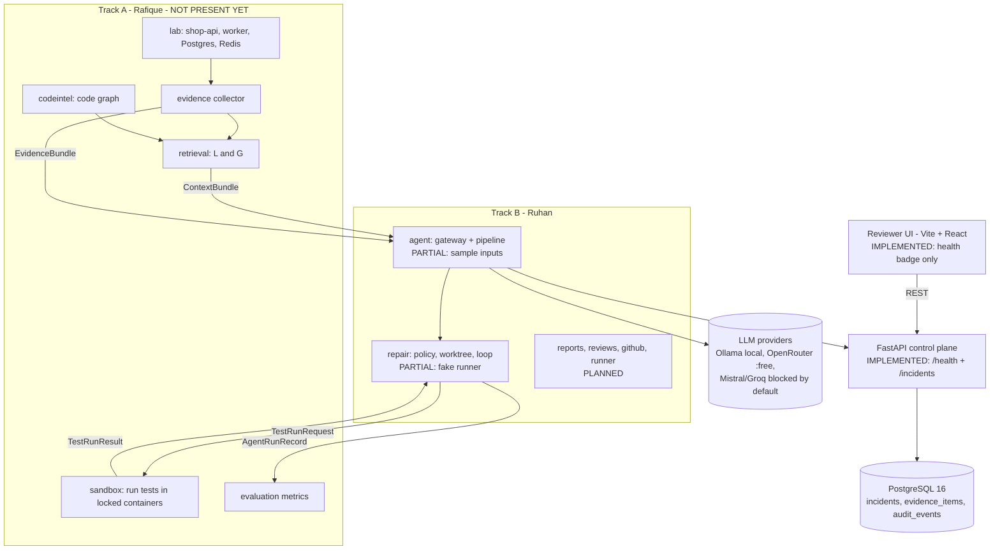

# Architecture

Back to [TraceForge Explained](TraceForge-Explained.md). Sources: `docs/plans/ARCHITECTURE.md` (design, "designed" status), `docs/plans/INTEGRATION_PLAN.md`, `docs/invariants/*`, and the real code. Where the design says one thing and the code another, this chapter reports the code.

## 1. Big picture

The project is split into **two tracks** that work in parallel and meet only through the **contracts** folder.

- **Track A (Rafique)**: the evidence side. Lab, datasets, evidence, code graph, retrieval, sandbox, evaluation metrics.
- **Track B (Ruhan)**: the agent side. Incidents, agent, repair, reviews, reports, GitHub intake, experiment runner, frontend.

In plain words: Track A produces **facts** (evidence) and **ranked code context**; Track B turns them into a **diagnosis**, a **patch**, a **verification result**, and a **review**.

## 2. The contracts (shared data shapes)

Folder: `backend/traceforge/contracts/`. **Status: Implemented.** A *contract* is a Pydantic model (a Python class that validates data). Both tracks code against it, so each can use a **sample JSON** until the other side exists.

| Contract (file) | Who produces it | Who uses it | Meaning |
|---|---|---|---|
| `CaseManifest` (`case_manifest.py`) | Track A fault generator (planned) | agent, evaluation | One fault case and its true answer (cause class, gold symbols/config keys, distance, test ids) |
| `EvidenceBundle` / `EvidenceItem` (`evidence.py`) | Track A evidence collector (planned) | agent tools, incidents DB | Redacted read-only facts, each with id `EV-0001` style, kind (`log`, `health`, `config`, `trace_frame`, `compose`, `issue`), SHA-256 |
| `ContextBundle` / `ContextHit` (`context.py`) | Track A retrieval (planned) | agent prompt | Ranked code/config snippets for one incident; mode `L` or `G`; must stay within its token budget |
| `TestRunRequest` / `TestRunResult` (`test_run.py`) | repair loop sends / sandbox returns | repair loop | Run suite `visible`, `hidden` or `reproducer` on a worktree |
| `AgentRunRecord` / `Diagnosis` (`agent_run.py`) | agent | evaluation | Everything one run did: condition, model, prompt hash, diagnosis, patch hash, tokens, cost, outcome |

Rules (README "Changing a contract"): a contract change is its own small PR; changes within a phase are additive only; paths inside contracts are repo-relative POSIX strings (the regex `^[^\\:]+$` rejects backslashes and drive letters). Three samples per contract (config case, code case, abstain case) live in `contracts/samples/`; JSON Schema is generated into `contracts/schema/`.

Built-in consistency checks (real validators in the code):
- A repairable case needs a gold target, a `distance` and hidden tests (`CaseManifest._repairable_needs_target`).
- `Diagnosis.abstained` must be true exactly when the cause class is `insufficient_evidence`; a non-abstaining diagnosis must cite evidence ids.
- `AgentRunRecord`: `NO_PATCH` cannot carry a patch; `TEST_VERIFIED_IN_LAB` requires `hidden_passed` true.
- `ContextBundle`: `tokens_used` may not exceed `token_budget`.

One additive change was made on 2026-11-21 (recorded in `docs/plans/RUHAN_CHECKLIST.md`): `AgentRunRecord.provider` became a free-form slug and optional `replicate`, `temperature`, `seed`, `failure_reason` were added. It is marked as needing a heads-up to Rafique (shared contract).

## 3. App core and health (Implemented)

- `main.py` creates the FastAPI app and includes the routers (health, incidents) and the 409 handler.
- `config.py` has the `Settings` class: the **only** place that reads environment variables (prefix `TRACEFORGE_`).
- `database.py` builds the SQLAlchemy engine and session.
- `health/` serves `GET /health`. It answers even if Postgres is down and says so (`status: degraded`, `db: down`).

## 4. Incidents (Implemented)

Folder `backend/traceforge/incidents/`. An **incident** is a row that moves through a **state machine**; each move writes an **audit event** (an insert-only history row with a hash of its payload). Details and the diagram are in [workflow](workflow.md). The HTTP surface:

| Method and path | Purpose |
|---|---|
| `POST /incidents` | Create (201). Needs `case_id`, or both `symptom` and `service` |
| `GET /incidents` | List, optional `state` filter, `limit` 1-100, `offset` |
| `GET /incidents/{id}` | One incident (404 if unknown) |
| `GET /incidents/{id}/events` | Audit trail |
| `GET /incidents/{id}/evidence` | Stored evidence items |

There is **no HTTP endpoint to change state** and none to start an investigation yet (`POST /incidents/{id}/investigate` is Planned for P2-S07/P3-S03). State changes happen by calling `service.transition()` from Python.

## 5. Agent (gateway Implemented; pipeline Partially implemented)

Folder `backend/traceforge/agent/`.

- **Gateway** (`gateway.py`, `cache.py`, `call_log.py`): one `chat()` function for any OpenAI-compatible provider. It checks the free-only guard, limits prompt size, caches responses on disk by a hash of the request, rate-limits, retries 429/5xx with backoff, and logs counts (never message text).
- **Pipeline** (`pipeline.py`, `diagnose.py`, `patch.py`, `tools.py`, `prompting.py`, `sources.py`): `run_case()` runs *snapshot, evidence, context, diagnose, patch request* and returns an `AgentRunRecord`.
- **Sources** (`sources.py`): three small interfaces (`CaseSource`, `EvidenceSource`, `ContextSource`) that Rafique's real evidence collector, retrieval and code graph will implement. Today only the **sample-JSON implementations** exist. So the pipeline has never run on real evidence or real retrieval.
- The LLM only gets four **typed, read-only tools**: `read_evidence`, `read_symbol`, `get_neighbors`, `submit_diagnosis`.
- In the pipeline, `get_neighbors` uses `SampleContextSource.neighbors`, which returns an empty list "until the real code graph (P2-S02)".

## 6. Repair (Partially implemented)

Folder `backend/traceforge/repair/`. `run_repair()` is the attempt loop: a baseline check, up to 3 attempts, a policy check on every patch, visible-suite runs, then the hidden suite once. It needs a `run_tests` function (the sandbox); the tests use a fake one plus real `git` worktrees on a toy repo. **It is not called from `run_case()`**; the pipeline's patch stage asks the model for a *unified diff* while the repair loop expects *SEARCH/REPLACE blocks* (`docs/domain/traceforge/index.md`: "Edits are search/replace blocks ... provisional until P0-S06 confirms"). Joining them is pending (P2-S04 integration).

## 7. Frontend (Implemented scaffold)

`frontend/`: Vite + React + TypeScript. One component, `HealthBadge`, reads `/health` through the dev proxy and shows `API ok`, `API degraded`, `API unreachable` or `Checking API…`. No incident or review screens exist (Planned: P3-S03).

## 8. Planned and Track A components

| Component | Planned job (from `docs/plans/ARCHITECTURE.md`) | Status |
|---|---|---|
| Lab | Docker Compose victim services: `shop-api` (FastAPI), `worker` (Redis queue consumer), Postgres, Redis | Owned by Rafique (not present yet) |
| Datasets | Fault templates, manifests (dev/test split), hidden tests, validator | Owned by Rafique (not present yet) |
| Sandbox | Run test suites in locked-down containers | Owned by Rafique (not present yet) |
| Evidence | Read-only collection (via a read-only Docker socket proxy), redaction, traceback parsing | Owned by Rafique (not present yet) |
| Codeintel | Graph from Python `ast`, Compose YAML and config keys, with provenance | Owned by Rafique (not present yet) |
| Retrieval | L and G context under one token budget | Owned by Rafique (not present yet) |
| Evaluation | Metrics (Recall@5, MRR, nDCG@10), rule baseline, statistics | Owned by Rafique (not present yet) |
| Reports | Deterministic template report from the evidence ledger (not AI-written) | Planned |
| Reviews | Approve/reject bound to the frozen patch hash | Planned |
| GitHub intake | Read an issue, create an incident, treat issue text as untrusted | Planned |
| Experiment runner | Batch runs per condition, resumable | Planned |

## 9. Design rules the code follows (`docs/invariants/`)

- Feature folders (`backend/traceforge/<feature>/`), not technical layers; files under about 300 lines.
- `router.py` is thin; logic lives in `service.py`; all DB access in `repository.py`; request/response models in `schemas.py`.
- ORM only (no raw SQL strings); append-only tables are never updated in place.
- Real data only: no invented numbers in UI, API or reports.
- Agent work runs outside the request (planned; not built yet).
