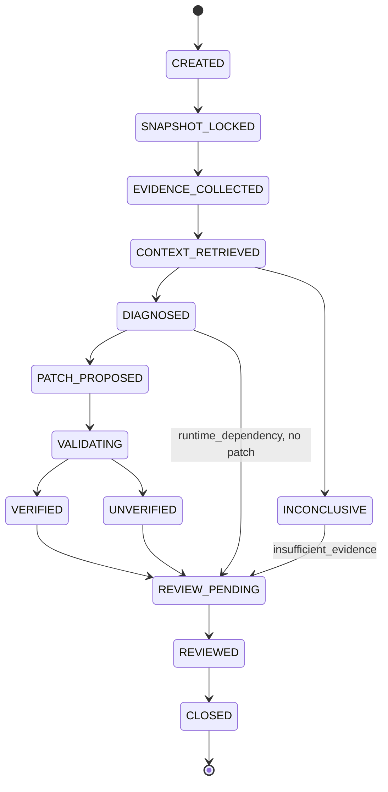
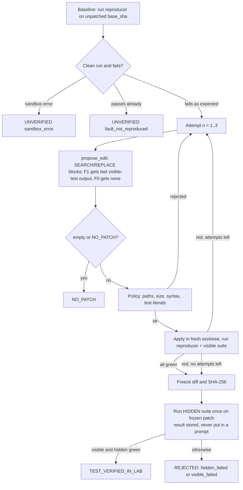

# Workflow: one incident, end to end

Back to [TraceForge Explained](TraceForge-Explained.md). Read [architecture](architecture.md) first if terms like "contract" or "gateway" are new.

## 1. The designed workflow (8 stages)

From `docs/plans/ARCHITECTURE.md` ("Data flow for one incident"). Labels show what exists today.

| # | Stage | Folder | Status |
|---|---|---|---|
| 1 | Intake: `POST /incidents` creates state `CREATED` | `incidents` | Implemented |
| 2 | Snapshot: pin `base_sha` (the exact commit) and Compose hash | `evidence` | Owned by Rafique (not present yet); the pipeline only *moves the state* and records `base_sha` |
| 3 | Evidence: build an `EvidenceBundle` | `evidence` | Owned by Rafique (not present yet); sample JSON used |
| 4 | Context: graph + retrieval build a `ContextBundle` (L or G) | `codeintel`, `retrieval` | Owned by Rafique (not present yet); sample JSON used |
| 5 | Diagnose: LLM with at most 6 read-only tool calls | `agent` | Implemented (on samples) |
| 6 | Patch: one LLM call returns a diff | `agent` | Implemented (the diff is **not** applied or policy-checked in the pipeline) |
| 7 | Verify: visible tests per attempt (max 3), hidden suite once | `repair` + sandbox | Repair loop Implemented against a fake runner; real sandbox not present |
| 8 | Report and review | `reports`, `reviews` | Planned |

## 2. The incident state machine (Implemented)

File: `backend/traceforge/incidents/states.py` (the map) and `service.py` (the guards).



Rules enforced by the code:
- Only the arrows above are legal. Any other move raises `IllegalTransition`, which the router turns into **HTTP 409** with the current state. Nothing is written.
- **Guards** (`_guard_failure` in `service.py`):
  - `DIAGNOSED` needs `payload.evidence_ids`: a non-empty list of ids that are stored for this incident.
  - `VERIFIED` needs `repro_before == "failed"` and `repro_after == "passed"` (a red/green pair: the bug test failed before, passed after).
  - `REVIEWED` needs `payload.review_id`.
- The actor must match `system`, `agent` or `reviewer:<name>`.
- Row lock, state change and audit event happen in one database transaction (`SELECT ... FOR UPDATE` on Postgres).

Exact code of the entry point's core (`backend/traceforge/incidents/service.py`):

```python
    current = incident.state
    if to_state not in ALLOWED[current]:
        reason = "transition not allowed"
    else:
        reason = _guard_failure(db, incident, to_state, payload)
    if reason:
        db.rollback()  # releases the lock; nothing was written
        raise IllegalTransition(current, to_state, reason)
```

The guard "no `REVIEWED` without a matching patch hash" from the design is **not** implemented yet: today `REVIEWED` only checks that a `review_id` string exists (reviews are Planned).

## 3. Diagnose loop (Implemented)

File: `backend/traceforge/agent/diagnose.py`.

1. Build a prompt from the template `prompts/diagnose_v1.md`, filled with the evidence (each item cut to 1500 chars) and the context hits (highest score first, never a path containing "hidden", within the character budget).
2. Call the model with the four tool schemas. Hard limit: `TOOL_BUDGET = 6` calls including the final `submit_diagnosis`.
3. Each call is validated by `tools.dispatch`. Bad arguments, unknown tools, unknown evidence ids and paths outside `lab/<service>/` raise `ToolError`; the model gets the error text, and `invalid_tool_calls` goes up.
4. Results are fed back wrapped as `TOOL RESULT <name> (untrusted data):` so the model treats them as data.
5. The loop ends in one of: a valid `submit_diagnosis`; an **abstain** with `budget_exhausted`, `model_output_malformed` (no tool call after one reminder), or `provider_error` (more than 2 gateway failures).

Abstaining is a safe outcome: cause class `insufficient_evidence`, no target, no patch.

## 4. Patch request (Implemented, not applied)

File: `agent/patch.py`. For repairable classes only (`configuration`, `application_code`), one call without tools asks for "one fenced diff block". `extract_diff` pulls it from the fence, and the SHA-256 of the diff becomes `patch_sha256`. For a `runtime_dependency` diagnosis no patch is requested and the incident goes straight to `REVIEW_PENDING`.

## 5. The repair loop (Partially implemented)

File: `backend/traceforge/repair/loop.py`, function `run_repair`. Condition is `F0` or `F1`.



Facts checked in the code:
- `MAX_ATTEMPTS = 3` and `FEEDBACK_CAP = 2000` characters.
- Feedback is built from the reproducer output and the **visible** suite only (`_feedback`), and only passed when `condition == "F1"`.
- The hidden suite is run exactly once, after the diff is frozen. `RepairResult.hidden_result` is "stored in the run record/DB, never in a prompt".
- Sandbox failure or timeout gives `UNVERIFIED`, never success (`_clean` requires no error and no timeout; `_green` needs `failed == 0` and `passed > 0`).
- If no attempt ever produced an acceptable diff, the result stays `REJECTED` with the reasons of the last attempt.
- Each attempt uses a disposable git worktree (`worktree.py`), removed in a `finally` block.

### The patch policy (`repair/policy.py`)
A patch is refused if it:
- touches more than 2 files or changes more than 60 lines (`MAX_FILES`, `MAX_CHANGED_LINES`);
- uses an absolute path, `..`, backslashes, or a symlink;
- edits a test file (regex `_TEST_NAME` covers `tests/`, `test_*.py`, `*_test.py`, `conftest.py`, `hidden_tests/`);
- touches a path not in the allowlist;
- contains NUL bytes (binary) or invalid Python syntax;
- **special-cases a test**: adds a new literal that also appears in the visible tests (`test_literal`, decision D31).
It also flags (does not reject) if an existing function signature changed (`signature_changed`).

### Edit format (`repair/edits.py`)
The model writes blocks like `<<<<<<< SEARCH path` / old text / `=======` / new text / `>>>>>>> REPLACE`. The old text must match **exactly once** (`no_match`, `ambiguous_match` otherwise). `to_unified_diff` then makes a deterministic diff for storage.

## 6. Concrete example from the contract samples

The files below are in `backend/traceforge/contracts/samples/` and are **hand-written samples**, not output of a real run. They are what the pipeline reads today (`SampleCaseSource` and friends).

**The case** (`case_manifest.config.json`): `cfg-redis-host-001`, service `worker`, cause class `configuration`, fault family `wrong_host`, gold config key `worker.REDIS_HOST`, distance `1`.

**The evidence** (`evidence_bundle.config.json`, abridged to the useful items):

| Id | Kind | Content |
|---|---|---|
| EV-0001 | health | `container traceforge-lab-worker-1: restarting (exit 1), restarts=4` |
| EV-0002 | log | `... ERROR worker.queue: cannot reach redis at redsi:6379` |
| EV-0003 | trace_frame | `lab/worker/queue.py` line 22, `redis.Redis(host=settings.redis_host ...)` then `ConnectionError ... redsi:6379. Name or service not known.` |
| EV-0004 | config | `REDIS_HOST=redsi`, `REDIS_PORT=6379`, `DB_PASSWORD=[REDACTED]` |
| EV-0005 | health | `container traceforge-lab-redis-1: running (healthy)` |

Note `DB_PASSWORD=[REDACTED]`: secrets are already removed before the model sees anything.

**The story**:
1. The worker keeps restarting (EV-0001). Its log says it cannot reach host `redsi` (EV-0002), which is a typo for `redis`. Redis itself is healthy (EV-0005), so it is not an outage.
2. Retrieval (the sample `context_bundle.config.json`, mode G) returns 3 hits: the trace frame `connect` in `lab/worker/queue.py` (score 1.0, reason `trace_anchor`), `WorkerSettings.redis_host` in `lab/worker/settings.py` (score 0.82, `graph_hop:1`, `reads_config:REDIS_HOST`), and the config key `cfg:worker.REDIS_HOST` in `lab/compose.yaml` (score 0.77, `config_binding`). This is why the case has **distance 1**: the symptom shows in `queue.py`, the cause is the config value one hop away. This is exactly where graph retrieval is expected to help over plain text matching.
3. The agent calls `read_evidence` on a few items, then `submit_diagnosis` with `cause_class = configuration`, `config_key = worker.REDIS_HOST`, supporting evidence ids.
4. The incident moves `CREATED -> SNAPSHOT_LOCKED -> EVIDENCE_COLLECTED -> CONTEXT_RETRIEVED -> DIAGNOSED`. The `DIAGNOSED` guard checks the cited ids really exist.
5. A patch is requested (config evidence is used as the code excerpt, because the target is a config key). The expected fix is to set `REDIS_HOST` back to `redis`. State becomes `PATCH_PROPOSED`.
6. **Today the pipeline stops here**: `run_case` returns an `AgentRunRecord` with `attempts=1` and `outcome="UNVERIFIED"` (code in `pipeline.py`), because verification is not wired in.
7. **Designed next steps** (Planned): the repair loop applies the fix in a worktree, the sandbox runs the reproducer (`repro.worker.enqueue_order_email`, visible test `test_consume_one_job`) and the hidden test (`test_worker_reaches_redis`), and the record becomes `TEST_VERIFIED_IN_LAB` if both pass. A hand-written sample of that final record is `agent_run_record.config.json` (condition G1, model label `devstral-small-latest`, `hidden_passed: true`); it illustrates the shape and is **not** a measured result.

The **abstain** sample (`case_manifest.abstain.json`, `abs-silent-worker-002`) has cause class `insufficient_evidence`, no gold target and log format `none`: the correct behaviour is to abstain and make no patch.

## 7. How to run the pipeline on the samples

Commands from `Taskfile.yml`: `task agent:run CASE=all CONDITION=G0` (records saved under `backend/runs/dev/`) and `task llm:smoke PROVIDER=ollama`. See [setup](setup.md). Note the retrieval "mode" passed to the sample context source is just the first letter of the condition (`condition[0]`); the sample bundles are fixed, so L and G give the same hits today.
