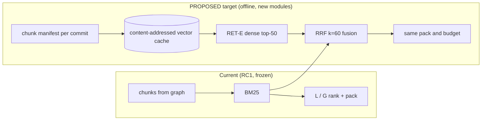
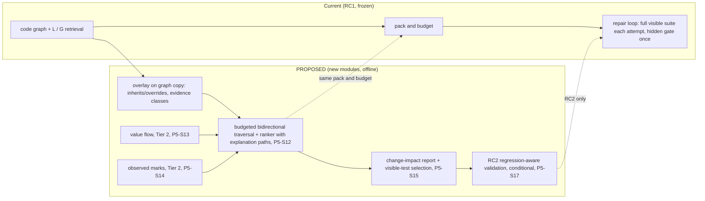

# Architecture

Status: **the original design below is the PLAN. Since 2026-11-25 a CURRENT-state summary is at the end of this paragraph; the rest of this file keeps the plan wording ("planned", "not implemented") and should be read as PROPOSED/historical where it differs from `docs/ARCHITECTURE.md`, which is CURRENT.** CURRENT: the backend modules, incident state machine, hash-bound review, GitHub intake, reviewer UI, runner and RC1 pipeline v5 exist; `POST /incidents/{id}/investigate` exists (202/404/409/422/503, background job, injectable factory, default real-sandbox factory untested live, needs `TRACEFORGE_MANIFEST` and a provider key); RC2 opt-in modules `agent/rc2/` exist and are not validated; `agent/hw_monitor.py` exists. The model provider in use is AxForge `glm-5.3-flash`, not Mistral (the External services table below is the plan; ADR 0001 is PROPOSED). Everything about embeddings, traversal overlays, impact reports and regression validation is PROPOSED. Original statement: Where this document and the earlier proposal architecture (`TraceForge_Architecture_Audited.md`, outside the repo) differ, this document reflects the decisions made after the supervisor review and is authoritative for implementation. Differences are listed in [DECISIONS_AND_OPEN_QUESTIONS.md](DECISIONS_AND_OPEN_QUESTIONS.md#contradictions-found).

## High-level view
```
 Reviewer UI (Vite + React)  ──REST──►  FastAPI control plane  ──►  PostgreSQL
                                             │
         ┌───────────────────────────────────┼─────────────────────────────────┐
         │ Track A (evidence side)            │ Track B (agent side)             │
         │  evidence   ◄── read-only proxy ── Docker lab (shop-api, worker,     │
         │  codeintel  ◄── lab source @SHA        postgres, redis)               │
         │  retrieval  ─► ContextBundle ──────►  agent (pipeline + gateway)      │
         │  sandbox    ◄── TestRunRequest ─────  repair (worktree, policy, loop) │
         │  evaluation ◄── AgentRunRecord ─────  reports / reviews / github      │
         └────────────────────────────────────────────────────────────────────────┘
                                             │
                     Mistral free API · Ollama (local) · Groq (spare)
```

## Components and owners
| Component | Folder | Owner | AI? | Responsibility |
|---|---|---|---|---|
| Contracts | `backend/traceforge/contracts/` | Shared | No | The five data shapes between tracks |
| App core | `backend/traceforge/{main,config,database}.py`, `health/` | Rafique | No | App factory, settings, DB session, `/health` |
| Lab | `lab/` | Rafique | No | Victim services with contracts, tests, probes |
| Dataset | `datasets/` | Rafique | No | Fault templates, manifests, hidden tests, validator |
| Sandbox | `backend/traceforge/sandbox/` | Rafique | No | Run test suites in locked-down containers |
| Evidence | `backend/traceforge/evidence/` | Rafique | No | Read-only collection, redaction, trace parsing |
| Code intelligence | `backend/traceforge/codeintel/` | Rafique | No | AST + Compose + config graph with provenance |
| Retrieval | `backend/traceforge/retrieval/` | Rafique | No (deterministic ranking) | L and G context bundles under one budget |
| Evaluation metrics | `backend/traceforge/evaluation/metrics/`, `baselines/`, `analysis/` | Rafique | No | Metrics, rule baseline, stats |
| Incidents | `backend/traceforge/incidents/` | Ruhan | No | Incident records, state machine, audit |
| Agent | `backend/traceforge/agent/` | Ruhan | **Yes** | Gateway, cache, pipeline, diagnose tools, patch request |
| Repair | `backend/traceforge/repair/` | Ruhan | No | Diff policy, worktrees, F0/F1 loop, hidden-test gate |
| Reports, reviews | `backend/traceforge/reports/`, `reviews/` | Ruhan | No | Deterministic report, hash-bound review |
| GitHub | `backend/traceforge/github/` | Ruhan | No | Issue → incident |
| Experiment runner | `backend/traceforge/evaluation/runner.py`, `conditions/` | Ruhan | No | Batch runs per condition |
| Frontend | `frontend/src/<feature>/` | Ruhan | No | Reviewer UI and results page |

## Data flow for one incident
1. **Intake** (`incidents`): `POST /incidents` (case or GitHub issue) → state `CREATED`.
2. **Snapshot** (`evidence`): pin `base_sha` + Compose hash → `SNAPSHOT_LOCKED`.
3. **Evidence** (`evidence`): build `EvidenceBundle` → `EVIDENCE_COLLECTED`.
4. **Context** (`codeintel` + `retrieval`): graph for `base_sha`; anchors from evidence; `ContextBundle` (L or G) → `CONTEXT_RETRIEVED`.
5. **Diagnose** (`agent`): LLM with read-only tools (≤6 calls) → hypotheses → `DIAGNOSED` or `INCONCLUSIVE`.
6. **Patch** (`agent` + `repair`): one LLM call → diff → policy check → worktree → `PATCH_PROPOSED`.
7. **Verify** (`repair` → `sandbox`): visible tests per attempt (≤3; F1 feeds output back), hidden suite once → `VERIFIED` or `UNVERIFIED`.
8. **Report + review** (`reports`, `reviews`) → `REVIEW_PENDING` → `REVIEWED` → `CLOSED`.

State machine: `CREATED → SNAPSHOT_LOCKED → EVIDENCE_COLLECTED → CONTEXT_RETRIEVED → DIAGNOSED | INCONCLUSIVE → PATCH_PROPOSED → VALIDATING → VERIFIED | UNVERIFIED → REVIEW_PENDING → REVIEWED → CLOSED`. Guards: no `DIAGNOSED` without evidence IDs; no `VERIFIED` without a red/green pair; no `REVIEWED` without a matching patch hash. `runtime_dependency` goes `DIAGNOSED → REVIEW_PENDING` with no patch; `insufficient_evidence` goes `INCONCLUSIVE → REVIEW_PENDING`.

## Contracts
Defined in P0-S05; full field list in [INTEGRATION_PLAN.md](INTEGRATION_PLAN.md#contracts). `CaseManifest`, `EvidenceBundle`, `ContextBundle`, `TestRunRequest`/`TestRunResult`, `AgentRunRecord`.

## API (planned; `/incidents/{id}/investigate` is CURRENT since 2026-11-25, others per their steps)
| Method | Path | Step |
|---|---|---|
| GET | `/health` | P0-S02 |
| POST | `/incidents` | P1-S04 |
| GET | `/incidents`, `/incidents/{id}`, `/incidents/{id}/events` | P1-S04 |
| POST | `/incidents/{id}/investigate` | P2-S07 (wiring), P3-S03 (UI) |
| POST | `/incidents/from-github` | P2-S06 |
| GET | `/incidents/{id}/report` | P2-S05 |
| POST | `/incidents/{id}/review` | P2-S05 |
| GET | `/evaluation/runs`, `/evaluation/report` | P3-S04 |

Paths beyond these are **[TO BE DECIDED]** in their steps.

## Database (planned tables)
`incidents`, `evidence_items`, `audit_events` (insert-only) — P1-S04; `patches` (frozen diff + SHA-256), `validation_runs` — P2-S04; `reviews` (insert-only) — P2-S05; run records stored as JSON files under `runs/` (git-ignored) and optionally indexed in a table — P3-S04 **[TO BE DECIDED: file-only vs table]**. Graph and LLM cache live on disk keyed by SHA (`.cache/graph/`, `.cache/llm/`), not in Postgres, for A3.

## External services
| Service | Use | Notes |
|---|---|---|
| Mistral API (free tier) | Primary LLM, pinned Devstral model | Model ID and limits recorded in ADR 0001 (P1-S05) |
| Ollama (local) | Comparator `qwen2.5-coder:7b`, offline fallback | 6 GB VRAM |
| Groq (free tier) | Spare for small checks | ~200K tokens/day on gpt-oss-120b |
| GitHub REST | Issue intake | Read-only token or unauthenticated for public repos |

## Authentication and authorization
A3: single-user local app; the reviewer identity on a review is a name field. **[TO BE DECIDED]** whether A4's public deployment needs login (P6-S02). Service authority is enforced in code, not by the LLM: tool allowlist per stage, path allowlist for patches, read-only Docker proxy, sandbox-only execution.

## Error handling
- Validation errors → 422 via Pydantic schemas.
- Illegal state transitions → 409 with the current state.
- Provider errors/rate limits → gateway retries with backoff, then records `UNVERIFIED`/`INCONCLUSIVE` with a reason; never fabricates output.
- Sandbox failure to execute → `UNVERIFIED`, never counted as success.

## Configuration
All settings through `traceforge/config.py` (`Settings`, prefix `TRACEFORGE_`), backed by git-ignored `.env`; `.env.example` lists names only. Lab services have their own Pydantic settings. Compose files reference `${VAR}` only.

## Research design
- **Factor G:** L = BM25 + traceback anchoring; G = L + graph distance, ≤2-hop expansion, config-key binding. Same candidate generator and token budget.
- **Factor F:** F0 = up to 3 fresh attempts; F1 = up to 3 attempts with visible-test feedback. Hidden suite once at the end in both.
- Conditions L0, G0, L1, G1; fixed model, temperature 0, prompts, tools, budgets. A3: E1 (retrieval only, all cases) + L0 vs G0 on ≥50 cases. A4: full 2×2 × 3 replicates.
- Every case labelled with `distance` (graph hops symptom → cause); ≥50% of test cases distance ≥1; results by distance.

## Retrieval architecture: current and proposed target
**Current (implemented, RC1 frozen):** the graph and chunk corpus are rebuilt in every process; BM25 (L) plus a 2-hop graph walk (G); no embeddings, no persisted index. **Proposed target (PROPOSED, not approved, offline only; decision gate is ADR 0003 after P5-S08):** an opt-in dense arm and RRF fusion in new modules outside the RC1 fingerprint list, fed by an incremental embedding index. **Status 2026-11-25:** P5-S08 gave a preregistered NO-GO, so the CURRENT architecture (BM25 + graph, no embeddings in the product path) is retained and ADR 0003 stays PROPOSED with the decision blank. The dense/hybrid code exists only as the opt-in research module `traceforge/retrieval_next`; the incremental index (`traceforge/index`) is implemented and tested (P5-S07); both were implemented by Ruhan's Claude-assisted session at the owner's direction on 2026-11-25 and are NOT reviewed by Rafique. The 'proposed target' is therefore not adopted.



**Incremental-index workflow (proposed, P5-S07):** (implemented and tested 2026-11-25 in `traceforge/index`; not wired into the product path.)
1. Chunk the tree deterministically; compute `chunk_key`, `content_hash`, `embed_key` (model, revision, dims, preprocessing).
2. Diff against the previous manifest: new / modified / deleted / moved (explains and audits).
3. Embed only chunks whose `embed_key` is missing in the model namespace (authoritative), in fixed batches, idempotent and resumable.
4. Refresh graph edges separately (re-link never triggers embedding).
5. Run the verifier (tree hash, content hashes, vectors present, dims, no NaN).
6. Write the manifest to a temp file, then switch the `ACTIVE` pointer atomically.
7. A model upgrade builds a new namespace; queries keep the old one until the pointer moves.
Details, scenarios and costs: [retrieval-architecture-review.md](../research/retrieval-architecture-review.md) sections 3 and 6.

## Deployment
- **A3:** everything local via Docker Compose; reproducible from the repo (rubric C5 alternative to a public link).
- **A4:** public deployment of the reviewer app showing saved runs/reports; lab and sandbox stay local. Host **[TO BE DECIDED]** in P6-S02.

## Root-cause traversal, impact report and regression validation (PROPOSED, 25 Nov 2026)
**Current architecture is unchanged.** Everything below is PROPOSED (pending owner approval Q18, decision D37), offline, in new modules (e.g. `backend/traceforge/analysis/`) working on a copy of the graph; `codeintel/` and RC1-fingerprinted files are not edited. Capabilities are evaluated, not guaranteed; no claim of complete root-cause or impact coverage.


Stages: (1) traversal and ranking (P5-S12, MVP); (2) impact report from patch diff and pre/post graphs (P5-S15, MVP); (3) regression validation in the repair loop (P5-S17, conditional, new fingerprint; hidden gate once, human approval unchanged). Evaluation: P5-S16. Design: [root-cause-impact-regression-design.md](../research/root-cause-impact-regression-design.md). Status 2026-11-25: stages 1 and 2 are implemented and tested in `traceforge/analysis/` (ranker preregistered NO-GO; impact report GO on fixtures); stage 3 is wired as an opt-in (`--rc rc2 --regression graph|s15`), no live model run. Not reviewed by Rafique.
