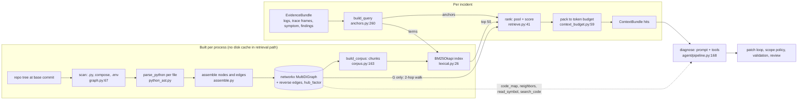

# Retrieval architecture review: lexical, graph and embedding options for TraceForge (24 Nov 2026)

Scope: read-only review. No repo file other than this one was written; no model or provider request was made; nothing was installed or pulled. Companion documents: [retrieval-embeddings-investigation.md](retrieval-embeddings-investigation.md), [technical-findings-2026-11-24.md](technical-findings-2026-11-24.md), [graph-performance.md](graph-performance.md).

Labels used throughout: **VERIFIED** (read in code or measured here, with file:line or command), **RECOMMENDATION** (my design proposal), **ASSUMPTION** (not measured; stated so it can be challenged), **PUBLIC** (fetched from a public model card or vendor page today).

A note on citations. The earlier investigation doc cites line numbers such as `retrieve.py:183` and `graph_ranker.py:297-424`. The files on disk today are shorter (`retrieve.py` 138 lines, `graph_ranker.py` 136 lines). The line numbers below are from the files as they are now; the logic described by the earlier doc matches them.

## 0. Summary

1. VERIFIED: there are no embeddings anywhere. Retrieval is BM25 over graph-derived chunks (L), and G adds symptom graph anchors plus a walk of at most 2 hops. Offline recall in the context actually sent is 23/29 (L) and 24/29 (G) (from the earlier doc; not re-measured here).
2. VERIFIED: the graph and chunk corpus are **rebuilt in every process** for every run (`cache_dir=None`, `retrieval/sources.py:36`); the only cache is an in-process dict (`corpus.py:212-222`). This is cheap at lab scale (0.16 s graph + 0.01 s corpus + 0.01 s BM25 for the whole `lab/`, measured here), so no persistent index is needed today.
3. VERIFIED: a content hash per function already exists in graph facts (`python_ast.py:228`, sha1 first 12 hex of the function text, stored as node attribute `hash` at `assemble.py:60`). It is not used by retrieval and is not a full sha256.
4. VERIFIED: scale is tiny. `lab/` yields 280 chunks (60 KB of chunk text, about 15k tokens by chars/4); the whole `backend/traceforge` package yields 1,683 chunks. A flat numpy matrix is sufficient at any size this project will see; a vector database is not justified.
5. VERIFIED hardware: Ryzen 5 2600 (6C/12T), 16 GB RAM, GTX 1660 SUPER 6 GB, 156 GB free on D:. Ollama is installed, its process is present, but its API did not answer within 3 s. torch, sentence-transformers, onnxruntime, faiss and sqlite-vec are absent from the backend venv.
6. RECOMMENDATION: do not add embeddings to the frozen RC1 path. Build an offline, opt-in `RET-E` prototype in new modules, evaluate on the dev split at equal token budget, and decide with preregistered thresholds. My honest prior is that embeddings help little on symptoms that already contain identifiers and traces, and may help on configuration-style and paraphrased symptoms; this is testable for 0 tokens.

## 1. Current architecture (VERIFIED)

### 1.1 Data flow



### 1.2 Chunking and identity

| Item | Fact | Evidence |
|---|---|---|
| What is a chunk | One per function/method (whole body), one per class (header only: at most 12 lines, cut before the first method), one per test function, one per config key, one per class-level simple/annotated assignment ("field") | `corpus.py:163-209`, `CLASS_HEADER_MAX_LINES = 12` at `corpus.py:23`, fields at `corpus.py:122-160` |
| Indexed text | `"<path> <qualname>\n" + source lines`, truncated to 6000 chars; config key chunk = key, lowercased key, path, declaration line, names of readers | `corpus.py:184`, `:195`, `:115`, `SOURCE_TEXT_CAP` at `:22` |
| Chunk ids | Graph id (`func:path::qualname`, `class:...`, `test:...`, `field:...`, `cfg:KEY`) and metrics `hit_id` (`sym:path::qualname`, `test:...`, `cfg:KEY`) | `symbols.py:12-17`, `corpus.py:65-77` |
| Id stability | Path-qualified, so a **move or rename changes the id**; ids are not content-hashed | `corpus.py:72` |
| Hashing | Per-function `hash` = sha1(function text)[:12], in facts and node attrs. Per-file sha256 keys the facts cache (`cache.py:15`). Graph `content_hash` = sha256 over per-file shas plus compose/.env shas (`graph.py:142-147`). Chunk text itself is not hashed; no per-chunk hash column exists | `python_ast.py:228`, `assemble.py:60`, `graph.py:142` |
| Corpus cache | In-process dict keyed `(repo, base_sha, content_hash)`, cleared when over 16 entries | `corpus.py:212-222` |

Measured here (command: a throwaway script in the session scratchpad calling `build_graph(path, cache_dir=None)` then `build_corpus`, writing nothing into the repo):

| Target | Python files | Chunks | Kinds | Chunk text total | Mean / max chars | Unique chunk contents | Graph | Corpus | BM25 build |
|---|---|---|---|---|---|---|---|---|---|
| `lab/` (shop_api, worker, probes, tests) | 42 | 280 | 201 symbol, 52 test, 27 config_key | 60,459 chars | 215 / 1,004 | 280 | 0.16 s | 0.01 s | 0.01 s |
| `backend/traceforge` | 180 | 1,683 | 1,645 symbol, 38 config_key | 700,552 chars | 416 / 6,000 | 1,683 | 1.35 s | 0.17 s | 0.15 s |

`lab/` graph: nodes 27 config_key, 24 class, 28 settings_field, 45 file, 80 function, 19 method, 4 service, 52 test, 13 unknown; forward edges 223 defined_in, 28 declares_config, 102 reads_config, 110 calls, 84 imports, 21 service_env, 2 service_runs, 5 depends_on, 71 tests_covers.

### 1.3 Graph construction

| Aspect | Fact | Evidence |
|---|---|---|
| Node kinds | file, class, function, method, test, settings_field, config_key, service, unknown | `assemble.py:26-198`, `compose_graph.py:143-196` |
| Edge types (forward / reverse) | calls/called_by, imports/imported_by, reads_config/read_by, defined_in/defines, tests_covers/covered_by, declares_config/declared_by, service_env/env_of, service_runs/run_by, depends_on/required_by | `codeintel/config.py:6-16` |
| Edge attributes | type, source (ast, compose, settings, dotenv), confidence, provenance `path:line`, weight | `builder.py:21-33` |
| Weights | reads_config 1.0, declares_config 0.9, service_env 0.9, service_runs 0.7, defined_in 0.6, calls 0.6, depends_on 0.5, tests_covers 0.4, imports 0.3; unknown-call confidence 0.2; hub threshold 12 | `config.py:36-59` |
| Inheritance edges | **Do not exist** (no `inherits` edge type). Method resolution through bases is done inside `Symbols.find_method` (`symbols.py:99`) to resolve call edges, but the inheritance relation itself is not an edge | `config.py:6-16` |
| Call resolution | Static, name/attribute-chain based with module index by path-suffix; unresolved calls become `unknown:` nodes (excluded from walks and adjacency) | `builder.py:36-74`, `assemble.py:131-132`, `graph.py:43`, `graph_ranker.py:95-99` |
| Incremental parse | Per-file facts cached by file sha256 and base_sha in `.cache/graph/*.json`; assembly is always redone | `cache.py`, `graph.py:126-140` |
| Who uses the disk cache | The retrieval path calls `build_graph(self.repo, cache_dir=None)` (`sources.py:36`) and E1 does too (`e1.py:122`). Only the codeintel CLI default (`DEFAULT_CACHE`, `graph.py:19`) uses it | grep result |

### 1.4 BM25, query, G arm, packing

- **BM25** (`lexical.py`): `rank_bm25.BM25Okapi` (k1 1.5, b 0.75 per the docstring; library defaults). Tokenizer splits identifiers on `_`, camelCase and digits, lowercases, drops tokens of length 1 and a small stop list, and keeps the whole identifier when it was split (`lexical.py:13-23`). Scores are divided by the best score; candidates are the top `TOP_K = 50` with positive score, ties by `hit_id` (`lexical.py:37-54`, `retrieve.py:25`).
- **Query** (`anchors.py:260-284`): `service + signal lines (error/exception/timeout... regex, at most 40 lines) + qualnames of trace frames + symptom terms (endpoint words, assertion identifiers, failing test names)`; repeated terms are kept on purpose (`anchors.py:159`). The BM25 query is a bag of de-duplicated terms (`lexical.py:35`).
- **Anchors**: innermost 2 project frames forced; other frames strength 0.5; up to 3 config keys that are literally named in log/trace/health/issue evidence, forced (`anchors.py:20-21,116-129,270-274`).
- **Scoring** (`retrieve.py:85-91`, weights `:28-38`): L = 0.30 lex + 0.25 anchor. G = L + 0.20 graph proximity + 0.10 test link - 0.10 uncertainty. Forced anchors get +1.0 so they rank first (`retrieve.py:110`). Weights are untouched initial values.
- **G arm** (`graph_ranker.py`): Dijkstra from each non-config anchor over calls, reads_config, declares_config, service_env, service_runs, depends_on, tests_covers; `MAX_HOPS = 2`; step cost `1/(weight x confidence)`, divided by the node's hub factor; a config key and its settings field bind at zero hop cost (`graph_ranker.py:17-21,80-119`). Symptom anchors (functions covered by failing tests, route handlers, settings read by anchored code) are G-only (`anchors.py:177-257`, `retrieve.py:58-59`). Expansion adds in-walk nodes that are not in the BM25 top 50 (`retrieve.py:72-75`).
- **Packing** (`context_budget.py:59-90`): usable = 80% of the budget (`RESERVE_FRACTION = 0.2`); cost = header + excerpt chars/4; at most 80 lines per excerpt; lines already emitted in the same file are skipped (a line-level de-dup); truncate to fit.
- **Budget**: `agent_context_budget_chars = 12000` (`config.py:72`); the pipeline calls `src.context.retrieve(evidence, None, condition[0], budget // 4)` (`agent/pipeline.py:168`), i.e. 3000 tokens, 2400 usable.

### 1.5 Evidence to diagnosis and patch

`pipeline.py:168-173` retrieves, records `CONTEXT_RETRIEVED` with the ranked hits (reasons, no source text), then calls `diagnose(...)`. The arm is chosen by the first letter of the condition (L or G); the feedback digit does not enter retrieval. The agent also has shared non-retrieval tools identical in all arms: `workspace_index`, `search_code` (name/docstring token overlap), `read_symbol`, `read_file`, `neighbors` (2 hops, hubs not expanded) and `code_map` (`sources.py:45-157`). `read_symbol`/`read_file` reject `hidden_tests`, `.git`, `..`, and (for edits) anything outside the case service's editable suffixes `.py .toml .ini .yaml` (`sources.py:19-25,66-80`). Patch generation, scope policy and validation are downstream and independent of retrieval.

### 1.6 Storage

VERIFIED: the Postgres schema has `incidents`, `evidence_items`, `audit_events` (`0001_incidents.py:41-81`) and `patches`, `validation_runs`, `reviews` (`0002_patches_validation_reviews.py:27-57`). There is no chunk, index or vector table. Both compose files use the plain `postgres:16` image (`compose.yaml:5`, `compose.prod.yaml:6`), which does not ship pgvector.

### 1.7 What is cached per base commit

| Artifact | Persisted? | Detail |
|---|---|---|
| Per-file parse facts | Only via codeintel CLI / explicit `cache_dir` | Key: base_sha + repo path hash, validated by file sha256 (`cache.py`) |
| Graph (networkx) | No; rebuilt each process | `sources.py:36` |
| Chunk corpus and BM25 | In-process only | `corpus.py:212` |
| Embeddings | Do not exist | |

Rebuild cost (VERIFIED from `graph-performance.md` and the measurement above): `lab/` cold 0.21-0.26 s (doc), 0.16 s plus 0.02 s for corpus and BM25 (measured here); the 100-file backend package cold 0.66-1.30 s. Retrieval build cost is negligible against model latency (the limits report measured about 45 s per 4k-token model call).

## 2. Modern approaches for Python code repair and debugging retrieval

### 2.1 Lexical

| Method | What it gives | Failure modes | Status here |
|---|---|---|---|
| BM25 over identifier-split tokens | Strong when the symptom shares names with the code (function names, error strings, keys) | Vocabulary mismatch (symptom says "tax wrong", code says `compute_levy`); long chunks dilute scores; stop-word handling is ad hoc | VERIFIED in use (`lexical.py`) |
| Trace-frame anchoring | Exact: file:line of the failing frame maps to a chunk | Useless when no trace exists (wrong value, no exception) | VERIFIED (`anchors.py:74-91`) |
| Config-key exact match | Literal key named in a log line | Not present when the message omits the key (the toy-shop spike shows a Windows resolver error without the host) | VERIFIED (`anchors.py:116-129`; spike in `limits-report.md`) |
| Fixed-string search (ripgrep, R0) | Cheap baseline | No ranking | VERIFIED baseline (`retrieval/baselines.py`, `e1.py`) |

### 2.2 Semantic (dense) retrieval

Facts are PUBLIC (model cards fetched 24 Nov 2026) unless marked. "Fits here" refers to the hardware in 2.6; nothing was downloaded or run.

| Model | Params | Dim | Context | License | Notes | Fits this machine (ASSUMPTION unless stated) |
|---|---|---|---|---|---|---|
| all-MiniLM-L6-v2 | 22.7M | 384 | 256 word pieces default; trained at 128 | Apache-2.0 | General text, not code-trained. `all-minilm:22m` is in the local Ollama store (earlier doc, file seen on disk) | Yes, CPU, milliseconds per chunk. Truncation at 256 pieces cuts most chunks (mean chunk here 215-416 chars is fine, max 6000 is not) |
| all-MiniLM-L12-v2 | about 33M | 384 | 256 | Apache-2.0 | Baseline; card not fetched | Yes (ASSUMPTION on size) |
| CodeRankEmbed (nomic-ai) | 137M | 768 (recollection, not stated on card) | 8,192 | MIT | Bi-encoder for code retrieval; queries need the prefix "Represent this query for searching relevant code." | Yes on CPU; sentence-transformers or ONNX required (not installed) |
| jina-embeddings-v2-base-code | 161M | 768 (recollection, not on fetched page) | 8,192 (trained at 512, ALiBi extrapolation) | Apache-2.0 | English plus about 30 programming languages, Python included | Yes on CPU |
| CodeSage base v2 | about 356M | 1024 | not stated | Apache-2.0 | Code embedding; small (about 130M) and large (about 1.3B) variants exist (recollection) | Yes on CPU, slower |
| Qodo-Embed-1-1.5B | about 1.5B (card shows 2B safetensors) | 1536 | 32k | QodoAI-Open-RAIL-M (use restrictions; read before use) | Code retrieval model | GPU 6 GB at fp16 about 3-4 GB weights: feasible but tight; slow on CPU |
| bge-code-v1 (BAAI) | about 2B on card | not stated (1536 by recollection) | card example uses 4,096 | Apache-2.0 | Qwen-based | Same class as Qodo-1.5B |
| nomic-embed-code | 7B | 3584 (recollection, not on card) | not stated | Apache-2.0 | Qwen2.5-Coder-7B based | Not realistic: fp16 about 14 GB; 4-bit about 4-5 GB would just fit 6 GB VRAM with no headroom; poor value for 280-1,700 chunks |
| text-embedding-3-small (hosted) | n/a | 1536 | 8,191 (recollection) | API | $0.02 per 1M tokens (PUBLIC: pricing page lists "text-embedding-3-small at $0.02") | Needs network and a key: adds an external dependency, breaks reproducibility unless vectors are cached |
| text-embedding-3-large (hosted) | n/a | 3072 | 8,191 | API | $0.13 per 1M tokens (ASSUMPTION: not on the fetched summary) | Same |

Cost at TraceForge scale, hosted: `lab/` is about 15k tokens, the 1,683-chunk package about 175k tokens (chars/4); at $0.02 per 1M that is under $0.01 per full index. Cost is not the issue; reproducibility, key handling and the "free local" project preference are.

Practical conclusion (RECOMMENDATION): for a first experiment use one general baseline (all-MiniLM-L6-v2, already on disk via Ollama) and one code-trained small model (CodeRankEmbed 137M, MIT, or jina-embeddings-v2-base-code 161M, Apache-2.0). Skip 1.5B-7B models: they cost GPU contention with local LLMs for gains that cannot be resolved on 33 dev cases.

### 2.3 Vector storage

| Option | Scale fit | Pros | Cons | Verdict |
|---|---|---|---|---|
| numpy flat (matrix of float32 + cosine by matmul) | 280 x 768 = 0.9 MB; 1,683 x 768 = 5.2 MB (arithmetic) | numpy 2.5.5 already in venv; exact search; deterministic; no new service; query is under a millisecond at this size (ASSUMPTION) | Re-implement save/load; no ANN (not needed) | **Use** |
| sqlite-vec | same | Single file, SQL joins with manifests; Apache-2.0/MIT (PUBLIC) | Pre-v1 with "expect breaking changes" warning (PUBLIC); needs `pip install` and extension loading | Optional later |
| pgvector in existing Postgres 16 | same | One store with incidents | Needs image change to `pgvector/pgvector:pg16` (PUBLIC) plus `CREATE EXTENSION` migration; HNSW indexable up to 2,000 dims (PUBLIC), so 3072-dim models cannot be HNSW-indexed; couples research indexes to the product DB | **Avoid** for now |
| FAISS | same | Mature | Needs install, no benefit below about 100k vectors; Windows wheels friction (ASSUMPTION) | **Avoid** |

### 2.4 Graph

| Capability | Exists in `codeintel` (VERIFIED) | Feasible additions (RECOMMENDATION) |
|---|---|---|
| Import edges (file to file) | Yes | Fine as is |
| Call edges | Yes, heuristic name/attribute-chain resolution with unknown fallback | `jedi` or `pyright` for type-aware resolution: more precision, heavy dependency and slow on Windows; probably unneeded at 37-180 files. No measurement of current call precision exists (`graph-performance.md` says so) |
| Inheritance / override edges | **No** edge type | Cheap to add from `ast.ClassDef.bases` into the existing `Symbols` machinery; matters for "subclass overrides the wrong method" faults |
| Config edges | Yes: settings field to env key, compose env, `os.environ`/`getenv`, `.env` | Strongest part of the graph; extend to pyproject/ini/yaml keys read via parsers |
| Test coverage edges | Yes: `tests_covers` from static calls in tests (conf 0.6) | Real coverage data (coverage.py contexts) would be dynamic and stronger but needs execution |
| Dynamic / runtime edges | No | `pycg` (static call-graph generator) is academic; tree-sitter gives faster, error-tolerant parsing but TraceForge parses with stdlib `ast`, which is adequate for Python-only labs |

Failure modes: unknown calls (13 in `lab/`, 69 in the package, VERIFIED above) are dropped from walks; hub nodes need down-weighting (implemented); a 2-hop walk expands recall but also context (G expansion is why earlier docs note precision stays at 4-6%).

### 2.5 Hybrid fusion and reranking

| Technique | Notes | Fit |
|---|---|---|
| Weighted score fusion | What L/G do now (0.30 lex + 0.25 anchor + ...). Needs comparable scales; BM25 is max-normalised, cosine is not | Works if the embedding score is also min-max normalised per query; tuning needs dev data |
| Reciprocal Rank Fusion, `score = sum 1/(k + rank)`, k = 60 | Scale-free, no tuning, standard default. Ignores score magnitude (a clear exact-match is no stronger than a weak rank-1) | Best first choice for RET-LE/LGE; keep forced anchors first as today |
| Cross-encoder rerank (e.g. a bge-reranker class model, ms-marco MiniLM) | Reads query plus chunk jointly; cost is `candidates x chunk tokens` per query: 50 candidates at 400 tokens is about 20k tokens of CPU inference, seconds on this CPU (ASSUMPTION). Not code-specific for the small ones | Feasible offline; add only if RRF shows gains and ranking quality, not recall, is the bottleneck |
| LLM rerank | Uses provider tokens and changes the experiment | Out of scope for retrieval-stage evaluation |

### 2.6 Hardware and environment (VERIFIED, commands run here)

| Item | Result |
|---|---|
| CPU | AMD Ryzen 5 2600, 6 cores / 12 threads (`Get-CimInstance Win32_Processor`) |
| RAM | 15.95 GB total |
| GPU | NVIDIA GeForce GTX 1660 SUPER, 6144 MiB, driver 621.14 (`nvidia-smi`) |
| Disk | C: 3 GB free; D: 156 GB free |
| Ollama | `ollama.exe` client 0.40.17; `ollama app.exe` process present; HTTP `localhost:11434/api/tags` timed out after 3 s; `ollama --version` warns it cannot connect to a running instance. So the server is not confirmed running. Model store contains `all-minilm:22m` (earlier doc) |
| Backend venv packages (listed `Lib/site-packages`) | present: numpy 2.5.5, networkx 3.7, rank_bm25 0.2.2, psycopg 3.3.9. Absent: torch, sentence-transformers, onnxruntime, faiss, sqlite-vec, pgvector, scikit-learn, tree-sitter, jedi. The venv has no `pip` module, so `pip list` is not available; the listing is from the directory |
| sqlite | 3.53.1 (`sqlite3.sqlite_version`) |
| Postgres image | `postgres:16` in both compose files |

Implication: C: has only 3 GB free, so any Hugging Face cache or Ollama store growth must be directed to D:. Installing torch (about 1-2 GB CPU wheel, ASSUMPTION) is a separate approved step; an ONNX/Ollama route avoids torch.

### 2.7 Do embeddings help debugging retrieval? Honest view

- Evidence from this project: the symptom contains identifiers (endpoint paths, failing test names, assertion identifiers, trace frames), and L/G already exploit them. In the frozen record retrieval is not the binding constraint: exact diagnosis was reached in 28/29 (L) and 29/29 (G) while gold was absent from the sent context in 6 and 5 cases (earlier doc, section C). The saturated benchmark cannot resolve small retrieval gains end-to-end.
- Where dense retrieval can plausibly add value (ASSUMPTION, to be tested): paraphrased symptoms ("discount is not applied" vs `apply_coupon`), config cases where the key is not named (frozen config recall is 0.33), and cross-file helpers sharing meaning but not names.
- Where it tends to hurt: exact-token queries (error strings, keys, numeric constants), short chunks like config keys and class headers (little text to embed), and near-duplicate code in a small repo (sibling services with identical function bodies embed almost identically). Fusion mitigates but does not remove noise.
- Prior (ASSUMPTION): a modest recall gain at rank 10-50 on paraphrase-style symptoms, no gain on trace-anchored cases, and a risk of precision loss at fixed token budget. This is why Section 5 insists on equal-budget comparison.

## 3. Incremental indexing and embedding architecture (RECOMMENDATION)

Everything in this section is a design; nothing here exists. It targets an offline research tool in new modules (see Section 6 for freeze constraints). At current scale (280 to 1,700 chunks, sub-second rebuilds) the incremental machinery is justified only for the embedding step, since embedding is the one expensive, model-dependent step; graph and BM25 can keep being rebuilt.

### 3.1 Identity model

| Key | Definition | Changes when | Purpose |
|---|---|---|---|
| `chunk_key` | `sha256(kind + "\0" + qualname)` within a repo namespace (path **excluded**), with `path` stored as metadata | the symbol is renamed or changes kind | Logical identity for "same symbol, maybe moved". Collisions (same qualname in two files) are disambiguated by adding the module-relative dotted path only on collision, recorded in the manifest |
| `content_hash` | `sha256(normalized_text)`; normalization: LF endings, strip trailing whitespace, expand tabs, optionally drop pure-comment line-number prefixes; **excludes** path and line numbers | the code text changes | Identity of what is embedded; rename/move reuses vectors |
| `embed_key` | `(content_hash, model_id, model_revision, dims, preprocessing_version)` hashed to one id | any of those changes | Primary key of the vector store (content-addressed) |
| `text_for_embedding` | `"{kind} {qualname}\n{source}"` (path deliberately omitted so moves do not re-embed; path goes to the lexical side) | `preprocessing_version` bump | Preprocessing pinned and versioned |

What exists today: `hit_id`/node ids are path+qualname (so renames/moves change them) and a 12-hex sha1 per function. RECOMMENDATION: add a full sha256 computed in the new module from chunk text rather than editing `python_ast.py` (frozen indirectly: see Section 6).

### 3.2 AST-aware chunking

Keep the existing boundaries (function/method whole, class header, test, config key, class field), because gold labels and metrics ids are defined on them (`corpus.py:6-13`). For embeddings only, add: a docstring-plus-signature header repeated on long functions that are split at statement boundaries beyond a model-specific token cap (CodeRankEmbed and jina 8,192 tokens make splitting rare; MiniLM's 256 pieces make it frequent and is a reason not to use it for functions). Config-key chunks are better embedded as short natural text (`"REDIS_HOST setting read by Settings.redis_host in cache.py"`) than as the current concatenation, or left lexical-only.

### 3.3 Content-addressed embedding cache and per-commit manifest

```text
store/
  models/<model_ns>/vectors.npy        # float32 [N, dims], append-only segments
  models/<model_ns>/index.sqlite       # embed_key -> row, created_at, status
  models/<model_ns>/model.json         # model_id, revision, dims, preprocessing_version, normalize flag
  manifests/<repo_ns>/<commit>.json    # per-commit chunk list (below)
  manifests/<repo_ns>/ACTIVE           # pointer file: names the active manifest + model_ns (atomic rename)
  wal/<run_id>.jsonl                   # write-ahead intent log
```

`model_ns = sha256(model_id + revision + dims + preprocessing_version)[:12]`. A new model is a **new namespace**; old namespaces stay until the active pointer is switched and a retention policy deletes them; dimensions are never mixed because each namespace has exactly one `dims` and one matrix file.

Manifest per commit (JSON lines or one JSON):

| Field | Meaning |
|---|---|
| `commit`, `repo_ns`, `tree_hash` | commit id (or `nogit`) and sha256 over sorted `(path, file_sha256)`, same idea as `graph.py:142` |
| `chunks[]` | `chunk_key`, `content_hash`, `kind`, `qualname`, `path`, `start`, `end`, `parent_key` |
| `edges_hash` | sha256 of the sorted edge list (type, src chunk_key, dst chunk_key, provenance) |
| `schema_version`, `chunker_version` | invalidates the manifest when the chunker changes |

SQL equivalent (if a table store is chosen later): `chunk(repo_ns, commit, chunk_key, content_hash, kind, qualname, path, start, end)`, `embedding(model_ns, content_hash, vector BLOB, created_at)`, `edge(repo_ns, commit, src_key, dst_key, type, provenance, confidence)`, `active(repo_ns, commit, model_ns)`, `tombstone(model_ns, content_hash, last_seen_commit)`.

### 3.4 Three update classes (kept strictly separate)

| Class | Trigger | Touches | Does not touch |
|---|---|---|---|
| Re-embed | `content_hash` is new for the namespace (text changed, or a new model namespace) | vectors, manifest rows | graph edges unless links changed too |
| Re-link | Same `content_hash`, but imports/calls/config-reference set changed (edge diff) | edge table, `edges_hash` | vectors (text unchanged) |
| Metadata-only | Same `content_hash` and `chunk_key`, but `path`/`start`/`end` changed (move, reformat outside the body) | manifest row only | vectors, edges (apart from provenance strings) |

Edge refresh is cheap and global (cross-file resolution is not incremental anyway, `graph-performance.md`): always recompute edges for the commit and diff; this is class "re-link" and never triggers embedding.

### 3.5 Manifest diff algorithm

```python
def plan(prev, cur, ns):                       # prev, cur: manifests; ns: model namespace index
    P = {c.chunk_key: c for c in prev.chunks}
    C = {c.chunk_key: c for c in cur.chunks}
    by_hash_prev = group(prev.chunks, key=lambda c: c.content_hash)
    new, modified, deleted, moved = [], [], [], []
    for k, c in C.items():
        p = P.get(k)
        if p is None:
            # same content under another key => rename or move
            twin = by_hash_prev.get(c.content_hash)
            (moved if twin else new).append((c, twin))
        elif p.content_hash != c.content_hash:
            modified.append(c)
        elif (p.path, p.start, p.end) != (c.path, c.start, c.end):
            moved.append((c, p))
    deleted = [p for k, p in P.items() if k not in C and p.content_hash not in {c.content_hash for c in cur.chunks}]
    need_embed = [c for c in cur.chunks if not ns.has(embed_key(c.content_hash))]   # authoritative
    relink = edges_hash(prev) != edges_hash(cur)
    return Plan(new, modified, deleted, moved, need_embed, relink)
```

The embedding decision is made by `ns.has(embed_key)`, not by the diff, so the diff only explains and audits; a cold start or a model change falls out of the same rule.

### 3.6 Workflow, failure handling and garbage collection

```python
def build(repo, commit, model):
    ns = Namespace.open(model)                         # creates dir + model.json if new
    cur = chunk_repo(repo, commit)                     # deterministic, no network
    pending = [c for c in cur.chunks if not ns.has(embed_key(c))]
    wal.append({"run": run_id, "commit": commit, "pending": [c.content_hash for c in pending]})
    for batch in batches(pending, size=32):            # fixed batch size and order for reproducibility
        vecs = model.encode([text_for_embedding(c) for c in batch])   # local, seeded, normalized
        ns.put_many({embed_key(c): v for c, v in zip(batch, vecs)})   # idempotent upsert; commit per batch
        wal.append({"run": run_id, "done": [c.content_hash for c in batch]})
    verify(cur, ns)                                    # every manifest chunk has a vector; dims match; no NaN
    write_manifest_tmp(cur); fsync(); os.replace(tmp, manifests/<commit>.json)
    atomic_write(ACTIVE, {"commit": commit, "model_ns": ns.id})   # the only visible switch
```

- **Idempotent batches / resume**: puts are keyed by `embed_key`; re-running after a crash skips present keys; the WAL records intent but correctness does not depend on it.
- **Atomic swap**: readers resolve `ACTIVE` once per query and open that manifest and namespace; a half-built manifest is never referenced.
- **Consistency verifier**: recompute `tree_hash` and every `content_hash` from the source tree and compare to the manifest; check each `embed_key` exists in the namespace and vector dims equal `model.json`; report orphans.
- **Tombstones and GC**: vectors not referenced by any retained manifest get `tombstone(last_seen_commit)`; physically deleted after N commits or on explicit `gc`; old model namespaces removed only after the active pointer has moved and a retention window has passed. Vector files are append-only segments; GC rewrites a segment to a new file and swaps it.
- **Model upgrade**: build the new namespace in the background (lazy, resumable); queries keep using the old namespace until `ACTIVE` is switched; mixed-dimension queries are impossible by construction.

### 3.7 Scenario table

"Cost" assumes the CPU embedding model with 137-161M parameters, a few tens of chunks per second (ASSUMPTION, unmeasured), and the lab-scale repo of about 280 chunks.

| Scenario | Chunks touched | Embeddings | Graph edges | Cost |
|---|---|---|---|---|
| 1. One function body changes | 1 modified chunk (`chunk_key` same, `content_hash` new); callers unchanged | 1 re-embed (old vector tombstoned) | Re-link only if its call/config set changed; usually edge set recomputed, diff empty | about 1 embedding (tens of ms) plus graph rebuild (0.2 s at lab scale) |
| 2. Function added | 1 new chunk | 1 embed | New defined_in/calls/reads_config edges from it; callers elsewhere unaffected unless they now resolve to it | 1 embedding plus graph rebuild |
| 3. Function deleted | 1 chunk removed from manifest | 0 (vector tombstoned, GC later) | Its edges removed; former callers' call edges become `unknown:` | graph rebuild only |
| 4. Function renamed (same body) | `chunk_key` changes; diff finds same `content_hash` under old key = renamed | **0** (content-addressed hit), unless the text hash includes the name; with `text_for_embedding` including qualname the hash changes and it is **1 re-embed** | Edges re-linked: call sites and callers update to the new name | metadata plus re-link (0-1 embedding). Decision: keep qualname out of `content_hash` only if embeddings should ignore names; for code retrieval names carry meaning, so 1 re-embed is the honest answer |
| 5. Import / dependency change | Chunk text unchanged | 0 | `imports` edges and call resolution through the changed import re-link; possibly many `calls` edges flip between resolved and unknown | graph rebuild; 0 embeddings |
| 6. Embedding model upgraded | All chunks (new namespace) | N re-embeds into the new namespace; old kept until switch | None | N x per-chunk cost: 280 chunks about seconds to under a minute on CPU for a 137M model; 1,683 chunks about a minute (ASSUMPTION); storage 0.9 MB / 5.2 MB per namespace at 768 dims |

## 4. Fit for TraceForge

Context (VERIFIED from docs and code): review-first repair, Dockerised services, small repos (lab 42 files), 3000-token retrieval budget, no GPU assumed for deployment (the dev machine has a 6 GB GTX 1660 SUPER but the product should not require it), hash-bound approval and hidden-test isolation downstream.

| Criterion | Lexical + graph (current) | + embeddings (proposed offline arm) |
|---|---|---|
| Recall | 0.69 / 0.72 gold recall in sent context (L / G); weak on config (0.33) | Unknown; plausible gains on paraphrase and unnamed config. Testable offline |
| Precision | 4-6% of sent chunks overlap gold, because the packer fills the budget | Not improved by embeddings per se; fusion plus dedup and a smaller K would |
| Tokens | 1,712 (G) to 2,336 (L) mean sent | Must be held equal in comparison |
| Latency | Sub-second build and query (measured here at lab scale) | Query embedding about tens of ms on CPU (ASSUMPTION); index build seconds with cache |
| Storage | None persisted | About 1-5 MB per namespace at 768 dims |
| Maintenance | Deterministic, no model | Model pinning, cache, namespaces, new dependency (torch/ONNX or Ollama) |
| Reproducibility | Strong (deterministic ties) | Needs pinned model revision, fixed batch size, float32, CPU-only; GPU kernels can alter low bits |
| Safety | No change | Must exclude hidden tests and gold artifacts from the embedded tree |

### Recommendation lists

| Action | Item | Reason |
|---|---|---|
| KEEP | BM25 with identifier-aware tokenizer; forced trace-frame and config-key anchors; G graph walk; shared packer and budget; deterministic tie-breaks | Verified working and frozen; trace anchors are the highest-precision signal |
| KEEP | Rebuild graph and corpus per process | Costs 0.2-1.4 s; a persistent index adds invalidation risk for no gain at this scale |
| IMPROVE (offline, new modules) | Add `inherits` edges; record per-arm retrieval latency in a non-fingerprinted logging path; add full sha256 content hashes in the new tooling; retrieval-only evidence-coverage metrics | Observability and measurement gaps named in earlier docs |
| IMPROVE (needs new experiment) | Dedup of near-identical chunks across services; smaller K or score cutoff to raise precision; dependency-aware expansion | Touches fingerprinted modules |
| ADD (offline) | `RET-E` dense retriever, `RET-LE`/`RET-LGE` RRF fusion, content-addressed embedding cache, manifest and verifier | Answers the open question at 0 tokens |
| ADD (later, conditional) | Cross-encoder rerank, structured evidence bundles | Only if RRF shows recall gains but poor ranking |
| AVOID | pgvector in the product DB, FAISS, 7B embedding models, hosted embeddings in the experiment, LLM-based query rewriting, any index containing hidden tests, fault patches or gold | Complexity, coupling, leakage, no scale justification |

Minimum viable path (about 3-4 dev days): numpy flat store, one baseline (MiniLM via Ollama or sentence-transformers) and one code model (CodeRankEmbed or jina-v2-code), RRF k = 60, offline on dev. Future work: manifest diffing and GC (only if repos grow 10x or the model changes often), reranker, ANN, graph inheritance edges.

## 5. Evaluation design (separate from the frozen experiment)

Arms (new names, new run directories, e.g. `runs/retrieval-bench/<run_id>/`, never `results/final/`):

| Arm | Definition |
|---|---|
| RET-L | Current L as-is |
| RET-G | Current G as-is |
| RET-E | Dense top-50 over the same chunks, same query text as BM25 (no LLM rewrite) |
| RET-LE | RRF(k = 60) of BM25 top-50 and dense top-50, forced anchors first as today |
| RET-LG | Current G (L plus graph) |
| RET-LGE | RRF of the G ranking and dense top-50, forced anchors first |
| +rerank variants | Only if a cross-encoder is installable and runs on CPU within reasonable time: RET-LE+R, RET-LGE+R; rerank the same top-50 candidates |

Protocol:

1. Data: dev split first (33 cases: 16 configuration, 15 application_code, 1 runtime_dependency, 1 insufficient_evidence, per the earlier doc), using the existing harness `retrieval/e1.py` (`Taskfile.yml:183` `eval:retrieval SPLIT=dev`). Gold labels are used only by the scorer. Saved evidence bundles must exist per case; otherwise cases are skipped by E1, and collecting them needs the faulty lab (effort risk).
2. Metrics: Recall@K, Precision@K and MRR for K in 1, 5, 10 and "in packed context"; nDCG@10 (existing `evaluation/metrics/retrieval.py`); source-localization accuracy (gold file / gold symbol at rank 1); evidence coverage (is a gold config key or runtime artifact present in the bundle); context tokens (chars/4, as the packer does); build and query latency; index build cost.
3. Show embeddings help rather than add context:
   - equal token budget: all arms packed by the same `pack()` at 3000 tokens (2400 usable);
   - budget-matched baselines: L and G with the budget raised to match the fused arm's tokens, so "just more context" is the null;
   - ablations: E alone, L+E, G+E, G without graph features (`GraphFeatures` all off must equal L: existing fairness test);
   - dedup: report results with and without line-overlap dedup and after collapsing near-duplicate chunks across services;
   - paired per-case differences with bootstrap 95% CIs (10,000 resamples, fixed seed); sign test as a secondary check;
   - report per cause class (configuration, application_code); runtime_dependency and insufficient_evidence (n = 1 each) are listed but not analysed.
4. Preregistration (commit before running; adapted from the earlier doc): H1: fused arm raises gold-in-packed-context recall on dev configuration cases over G by at least 0.15 absolute; H2: no loss on application_code beyond 0.05; H3: precision at equal tokens at least G; H4: E alone is worse than BM25 on identifier-heavy queries. Fix k in {30, 60}, one run each, no tuning loops. Decision rule: only if H1 and H2 hold on dev is any downstream stage proposed.
5. Contamination controls: do not touch the test split (151) or the frozen 35; do not index `hidden_tests`, `datasets/cases/*/mutation.patch`, gold manifests or fault-generator artifacts; embed only the tree the agent can see, with the same filters as `sources.py:19` and `agent/prompting.py` hidden-path filter; frozen RC1 code fingerprint (`ee3d8d87...` per the findings doc) must be unchanged before and after (recompute with `code_fingerprint()`); new run directories and condition names; model id, revision, dims, preprocessing version, batch size, seeds and package versions recorded in `run_meta`; determinism check: two runs give identical rankings.
6. Downstream (stage 2, only after stage 1 passes): H-conditions with the diagnosis/patch pipeline, preregistered separately, with replicates, new run dirs. Because RC1 exact diagnosis is already 28-29/29, the benchmark is near saturation; the findings doc already recommends a harder case set before spending tokens.

## 6. Repair pipeline interactions

### 6.1 What is frozen (VERIFIED: `evaluation/fingerprint.py:15-37`, 28 files)

- Agent: `agent/diagnose.py`, `tools.py`, `patch.py`, `pipeline.py`, `symptom.py`, `evidence_view.py`, `prompting.py`, `handoff.py`, `agent/prompts/diagnose_v2.md`, `agent/prompts/patch_v5.md`, `agent/real_sources.py`, `agent/repair_run.py`.
- Retrieval: `retrieval/anchors.py`, `retrieve.py`, `graph_ranker.py`, `routes.py`, `lexical.py`, `corpus.py`, `context_budget.py`, `sources.py`.
- Repair and safety: `repair/scope.py`, `repair/policy.py`, `repair/loop.py`, `repair/feedback.py`.
- Diagnostics and evidence: `diagnostics/__init__.py`, `diagnostics/rules.py`, `evidence/collector.py`, `evidence/logs.py`.

Not in the list (VERIFIED by reading `FILES`): `retrieval/compare.py`, `baselines.py`, `e1.py`, and all of `codeintel/*`. Caution (VERIFIED reasoning): `codeintel` determines graph nodes and edges that the frozen retrieval consumes, so editing it can change RC1 behaviour while the fingerprint stays equal. RECOMMENDATION: treat `codeintel/` as de facto frozen and add the `inherits` edge or sha256 hashes via new subclass/wrapper code instead, or add `codeintel/*` to a future fingerprint.

### 6.2 Possible without changing RC1

New modules not imported by any frozen file: `retrieval/dense.py`, `retrieval/hybrid.py`, `retrieval/embed_store.py`, offline scorer scripts, per-arm latency logging written by the benchmark harness itself, dev-split benchmark runs, documentation, tests. These do not alter the fingerprint as long as no frozen file imports them.

### 6.3 Needs a new experiment

| Candidate | Why it changes behaviour | Safety unchanged? |
|---|---|---|
| Dependency-aware context expansion (callers/callees/base classes of anchors in the bundle) | Changes what the model sees; touches `retrieve.py`/`sources.py` | Yes: scope policy and approval are independent |
| Structured evidence bundles (config evidence, runtime evidence, code, tests as labelled sections) | Prompt and packer change | Yes |
| Dedup of near-identical chunks | Packer change | Yes |
| Reranking | Ranking change | Yes |
| Patch constraints (allowed files from retrieval, line budget) | `repair/scope.py`/`policy.py` change | Must be additive restrictions only; scope policy, hash-bound approval and hidden-test isolation (`sources.py:19-80`, hidden suite never shown to the model) stay as they are |
| Feedback from validation into retrieval (re-retrieve with failing test output) | `repair/loop.py`/`feedback.py` change | Hidden-suite output must never feed back; only visible-suite output |
| Abstention (return insufficient_evidence when retrieved evidence is weak) | `diagnose`/handoff change | Strengthens review-first stance; 3 + 3 non-repairable sites in the frozen set make it measurable |

## 7. Costs, effort and risks

| Work item | Dev days (ASSUMPTION) | Tokens | Storage | Latency |
|---|---|---|---|---|
| Baseline offline benchmark of RET-L/RET-G on dev, with per-arm latency | 1-1.5 | 0 | negligible | retrieval query under 1 s at lab scale (build 0.2 s measured) |
| Dense retriever module plus numpy store plus one model (via Ollama or sentence-transformers) | 1-1.5 | 0 | 1-5 MB per namespace at 768 dims | index build seconds to a minute; query embedding tens of ms (unmeasured) |
| RRF fusion arms and ablations | 0.5-1 | 0 | none | negligible |
| Manifest, content-addressed cache, verifier, GC | 1.5-2.5 | 0 | manifests tens of KB | rebuild proportional to changed chunks |
| Cross-encoder rerank (optional) | 1 | 0 | model about 100-500 MB (ASSUMPTION) | seconds per query on CPU |
| Analysis, preregistration, write-up | 1-1.5 | 0 | none | n/a |
| Total minimum viable (first four rows excluding manifest/GC) | about 3.5-5 | 0 | under 10 MB | n/a |

Assumptions stated: CPU throughput of tens of chunks per second for 100-200M code models; chunk counts from the measurements in section 1.2; no installation friction beyond one package set; dev bundles available or collectable.

Risks and limitations:

- Leakage: an index that includes fault patches, hidden tests or gold manifests would invalidate results. Mitigation in section 5.
- Dev n = 33 with n = 1 for two classes: only configuration and application_code are analysable; CIs will be wide.
- Ceiling effect: downstream gains are bounded by 28-29/29 existing success; stage 1 measures retrieval only.
- Measurement caveats carried from the earlier doc: config-key chunks are matched by id only; "sent" credit uses line overlap; no per-arm latency exists in saved artifacts.
- This review did not measure embedding throughput, model quality on this dataset, or call-graph precision; all such numbers above are labelled ASSUMPTION. Embedding dimensions for CodeRankEmbed, jina-v2-code and nomic-embed-code were not on the fetched pages and are from recollection.
- Dependency risk: torch/ONNX is a new, large dependency on a machine with 3 GB free on C:. Ollama's server was not responding, so the Ollama route needs a start-up check before relying on it.
- `codeintel` is outside the fingerprint but behaviour-affecting (section 6.1).
- sqlite-vec is pre-v1; pgvector requires an image change; neither is needed.
- Follow-up design (25 Nov 2026): root-cause discovery, dependency traversal, change impact and regression safety are in [root-cause-impact-regression-design.md](root-cause-impact-regression-design.md) (PROPOSED; tasks P5-S12 to P5-S17).
